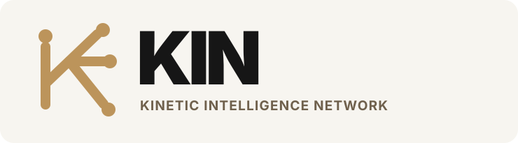

<div align="center">
  

  # KIN — Kinetic Intelligence Network

  **Life changes. KIN moves with you.**

  *More than a calendar. A calmer way to live.*

  **Independent, student-built AI hackathon prototype focused on Oakland University and Michigan.**
</div>

---

## Why KIN?

A Michigan winter-weather alert can affect a student's exam commute. The same student may also want to attend an Oakland University game, handle a work shift, and keep personal plans on track. **KIN explores how one change may affect the commitments the user has chosen to share.**

Our goal is to connect **responsibilities and opportunities** in one experience—without pretending that AI can verify university cancellations, road safety, or actions it hasn't performed.

## What we're building

| Workflow | Experience | Verification standard |
| --- | --- | --- |
| **Student schedule** | Enter a fictional class/exam manually or via Gemma-extracted text | Dates and conflicts validated by deterministic code |
| **Michigan weather** | Retrieve National Weather Service forecasts and alerts | Official NWS endpoints; visible source/update status |
| **Ripple Engine** | Identify potential overlap between weather-warning time and an example commitment | Time-window rules; *not* a school-closure or travel-safety decision |
| **Opportunity Radar** | See source-linked OU sports and campus event examples | Published start time with source link; estimated ends labeled |
| **Approval Center** | Propose an event insertion, explicitly approve or reject | Changes only to the demo/session calendar, with confirmation |
| **Customizable companion** | Choose an assistant nickname without renaming KIN | Guest-mode demo; no university password required |

> **Current status:** Proof-of-concept under development for Hacktoberfest Hack Day Rochester × GrizzHacks, October 30, 2026. The public `main` branch may not yet include the separately developed application. The capabilities above are **target demo behaviors**, not a statement that all integrations have been independently tested or deployed. Check merged code and actual run results before claiming completion.

## How the AI works

```text
Fictional student input ──> Gemma 4 extracts a structured proposal
                                     │
                                     ▼
                          Python validates dates / consent
                                     │
Official NWS data ─────────> KIN scheduling & impact rules <──────── OU event examples
                                     │
                                     ▼
                           Grounded Gemma 4 explanation
                                     │
                                     ▼
                         User reviews a proposed action
                                     │
                                     ▼
                         Explicit approval / rejection
                                     │
                                     ▼
                            Verify local state changed
```

**Gemma 4 is the intended open-weight language model.** It interprets natural language and explains structured information; it does **not** determine official university closures or authorize calendar changes.

**Important trust boundaries**
- Fictional student schedules are used for demonstration; no direct MySAIL or Moodle integration is claimed.
- Live NWS information and simulated severe-weather scenarios must be visually distinguished.
- If a public API fails, mark the source **unavailable**, not “safe” or “no alerts.”
- OU announcements must be verified independently; a warning does not mean classes are canceled.
- Every consequential action needs user approval.
- Never commit API keys, `.env` files, private calendars, or real student records.

## Product experience

| Today | Schedule | Discover | KIN AI | Settings |
| --- | --- | --- | --- | --- |
| Upcoming commitments and possible impacts | Combined example timetable | Sports, gaming and campus activities | Explanation and event extraction | Companion name, preferences and privacy |

A separate pitch website has been developed in [website PR #4](../../pull/4). It uses a **scripted floating assistant preview**, not a live Gemma-powered conversation. Do not present that preview as working model inference.

## Technology / planned stack

- **Python + Streamlit:** quick interactive prototype
- **Gemma 4:** meaningful open-weight AI inference via supported runtime/API
- **National Weather Service:** official public forecast and alert endpoints
- **Python interval logic:** schedule overlaps, user-chosen planning buffers, approvals
- **JSON + in-memory state:** reproducible fictional demo events; no production database
- **pytest:** core logic tests

Actual dependency versions and startup commands belong to the application implementation once merged. Avoid mistaking this brand/README branch for a runnable Streamlit app.

## Presenting KIN

**60–90 second demo storyline**
1. Fictional OU student enters a biology exam.
2. Gemma 4 extracts and validates the commitment, followed by an approval click.
3. A clearly labeled *simulated* Michigan winter warning overlaps the example commute period.
4. KIN links to official NWS and OU status information and explains the uncertainty.
5. A source-linked Golden Grizzlies event fits the demo timetable; the user approves adding it.
6. The local calendar and action log confirm the result.

**Key distinction:** an ordinary weather app describes weather; a calendar displays appointments; KIN aims to relate relevant changes and opportunities to **a person's selected commitments**, using rule-based checks and AI explanations.

## Sources

- [NWS Web Services API](https://www.weather.gov/documentation/services-web-api)
- [NWS Alerts](https://www.weather.gov/documentation/services-web-alerts)
- [Oakland University Campus Closings](https://www.oakland.edu/police/emergency-management/campus-closings/)
- [OU Events Calendar](https://calendar.oakland.edu/)
- [OU Golden Grizzlies Athletics](https://goldengrizzlies.com/)
- [Google Gemma documentation](https://ai.google.dev/gemma/docs/)

## Branding

The project name is **KIN — Kinetic Intelligence Network**.

Our KIN **Campus Edition** visual language uses OU-*inspired* black, white, and gold, with an **original connected-path symbol**:
- OU-inspired gold `#BC945B`
- Black `#000000`
- White `#FFFFFF`
- Warm neutral `#F7F5F0` (KIN-specific addition)

Source files:
- [KIN wordmark](assets/kin-wordmark.svg)
- [KIN app icon](assets/kin-icon.svg)
- [Brand use guidance](docs/BRAND_ASSETS.md)

**KIN is independent of Oakland University.** We do not use OU's official athletics mascot, seal, or university trademarks as our own logo, and we do not claim university endorsement. KIN trademark clearance is not established.

## Contributing & licensing

This is an open-source hackathon project. For bug reports, improvements, and design feedback, open an issue or a pull request. Do not upload student private information or API secrets.

Code in this repository is licensed under [MIT](LICENSE). Third-party model weights, sources, and external assets remain subject to their own terms.

**Repository:** https://github.com/mbilal-OU/KIN
