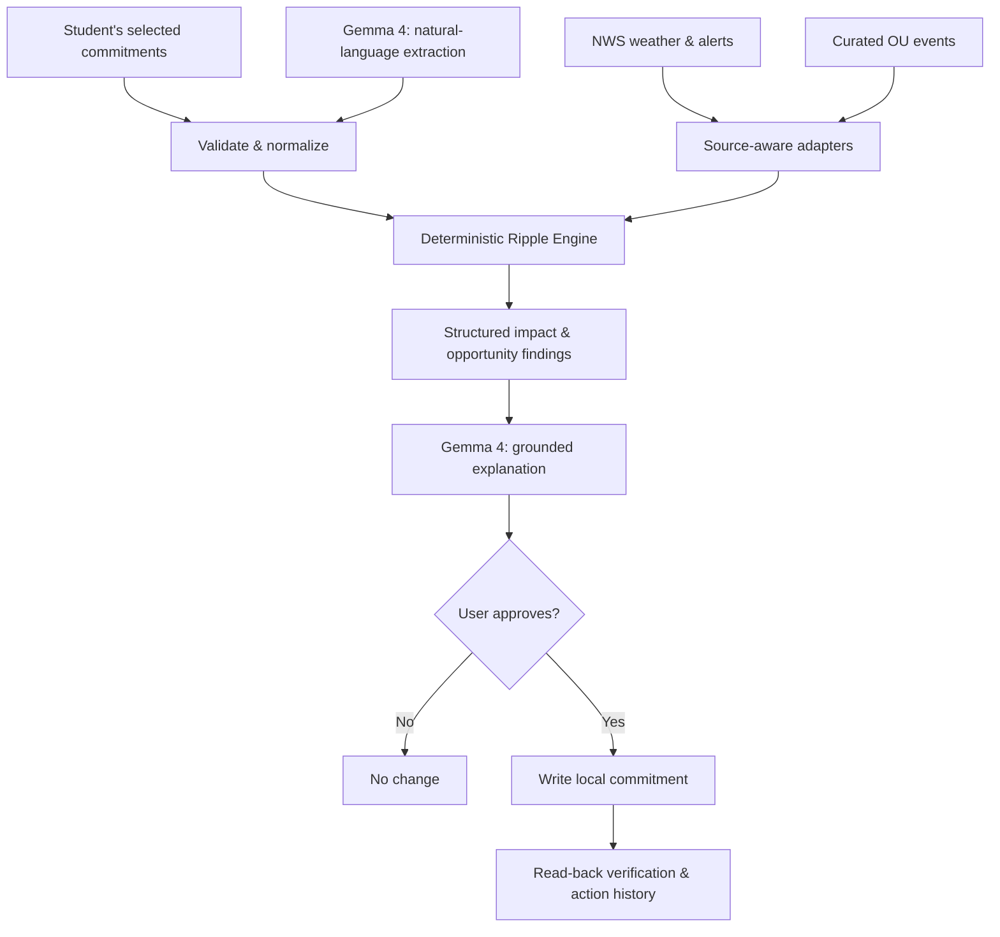

<div align="center">


# KIN
### Kinetic Intelligence Network

**Life changes. KIN moves with you.**

An open-weight AI companion for the commitments, disruptions, and opportunities that shape your day.

[](https://www.python.org/)
[](https://streamlit.io/)
[](https://ai.google.dev/gemma)
[](https://www.weather.gov/documentation/services-web-api)
[](LICENSE)

[**Get started**](#quick-start) · [**See what it does**](#the-experience) · [**How it works**](#how-kin-works) · [**Project documentation**](#documentation)

</div>

---

## A more connected day

A student commuting to Oakland University has an exam at 9:00 a.m. A Michigan weather alert may affect their plans. Their calendar knows the exam time; a weather app knows about the alert; the university publishes its own updates. **None of those sources, on its own, explains how the pieces fit together.**

KIN brings selected commitments and external information into one place. It identifies relevant timing conflicts, explains what is known and what is uncertain, and offers the next useful action—**without making decisions for the user**.

The first edition focuses on Oakland University students and southeastern Michigan. The underlying planning model can also represent work, family, and personal commitments.

> **Core principle:** Rules decide. The model explains. The user approves.

## The experience

| Plan your day | Prepare for changes | Make room for life |
| :--- | :--- | :--- |
| Add classes, exams, shifts, meetings and personal commitments. Gemma 4 can interpret a natural-language entry into a proposed calendar item. | Check National Weather Service information against your timetable and a user-defined planning buffer. See relevant impacts with source details. | Discover source-linked Oakland University activities and check whether an event fits your selected timetable before approving an addition. |

### A typical KIN journey

1. **Plan.** Enter a fictional commitment, such as “Biology study meeting, Friday at 5 p.m.” Gemma 4 proposes structured event details; KIN validates the times before the user accepts them.
2. **Check.** Retrieve the NWS forecast and alerts for an approximate Michigan location. KIN's scheduling rules compare alert windows with selected commitments.
3. **Understand.** Receive a short explanation of potential conflicts, with official sources and uncertainty clearly separated. A weather alert **does not** establish a university closure.
4. **Discover.** Explore an officially sourced OU athletics event. The app checks it against the current timetable and flags any estimated end time.
5. **Approve.** Review the proposed calendar change. KIN writes it to the local store only after approval and verifies that it was saved.

The included winter-warning demonstration is **explicitly simulated**. It is not a real NWS warning.

## What is implemented

The repository contains a Streamlit application and a local, single-user proof of concept. Current functionality includes:

| Area | Functionality |
| :--- | :--- |
| **Planning** | Manual commitment management, event categories, conflict detection, free-time windows and a what-if simulator |
| **AI assistance** | Gemma 4 event extraction, grounded daily briefings and Q&A over supplied context; distinctly labeled non-AI fallback when unavailable |
| **Michigan weather** | NWS hourly forecast and active alerts, request timestamps, location checks and explicit unavailable states |
| **Campus discovery** | Curated, source-linked OU athletics events, schedule compatibility checks and approval-based local additions |
| **Personalization** | Named workspaces, assistant nickname, planning buffers and user preferences |
| **Calendars and data** | iCalendar (`.ics`) preview/import/export, local SQLite storage, JSON export and full local erasure |
| **Trust controls** | Source provenance, simulation labels, duplicate prevention, action history and approval verification |

**Not implemented:** MySAIL/Moodle account access, authenticated multi-user accounts, real calendar OAuth sync, road-safety predictions, or push/SMS/email notifications.

See [feature status](docs/FEATURES.md) for the test evidence and known gaps behind each item.

## Quick start

**Requirements:** Python 3.11 or later; internet access for NWS and hosted Gemma inference. No university account is required.

```bash
git clone https://github.com/mbilal-OU/KIN.git
cd KIN

python -m venv .venv
```

Activate your virtual environment:

| macOS / Linux | Windows PowerShell |
| :--- | :--- |
| `source .venv/bin/activate` | `.\.venv\Scripts\Activate.ps1` |

Install dependencies:

```bash
python -m pip install -r requirements.txt
```

Copy the example configuration and add your own API key:

```bash
# macOS / Linux
cp .env.example .env

# Windows PowerShell
# Copy-Item .env.example .env
```

Set the following entries in `.env`:

```dotenv
KIN_AI_PROVIDER=gemini
GEMINI_API_KEY=your_private_key
KIN_GEMMA_MODEL=gemma-4-26b-a4b-it
```

Obtain an API key from [Google AI Studio](https://aistudio.google.com/apikey). **Never commit your `.env` file or use private student information for hosted demo prompts.**

Start the app:

```bash
python -m streamlit run app.py
```

Open **http://localhost:8501**. The application can run without an AI key, but model features will show a clearly identified deterministic fallback rather than a Gemma response.

### Run Gemma locally instead

If your machine has adequate resources, use [Ollama](https://ollama.com/) and download the supported model:

```bash
ollama pull gemma4:e2b
```

Then select `KIN_AI_PROVIDER=ollama` in your local `.env` and configure `KIN_OLLAMA_MODEL=gemma4:e2b`. Local-model download size and hardware requirements vary.

## How KIN works



**Gemma 4 handles language.** It converts free text into candidate event details and explains findings drawn from the supplied state. **Python handles the rules:** date validation, Michigan time-zone offsets, time-window overlaps, buffers, source status and action permissions.

The model has no direct calendar write tools. Proposals are validated, shown to the user and applied only with explicit approval.

For the implementation details, see [architecture](docs/ARCHITECTURE.md) and [integrations](docs/INTEGRATIONS.md).

## Testing

```bash
# Offline automated tests; external API calls are mocked
python -m pytest -q

# Optional manual integration check; uses real NWS and Gemma API access
python tests/live_smoke.py
```

The repository includes unit tests for scheduling, validation, storage and AI boundaries, plus Streamlit application tests. The separate live smoke test exercises real provider connections and may consume API quota.

See [test coverage and limitations](docs/TESTING.md). A passing offline suite does not by itself confirm that a publicly hosted demo is reachable or that a live model call will succeed.

## Privacy, accuracy and scope

KIN is an **independent Oakland University-inspired hackathon project**, not an official university application or emergency notification service.

- **Source-aware, not source-omniscient.** Weather information comes from NWS. KIN links to the [official OU campus closings page](https://www.oakland.edu/police/emergency-management/campus-closings/) but does not independently establish an exam or class cancellation.
- **A planning buffer is not a travel-time estimate.** KIN does not assess road safety or guarantee arrival.
- **Simulations stay simulations.** Fictional severe-weather examples are labeled and kept separate from live alerts. If an API is unavailable, KIN says so.
- **Local storage is not multi-user security.** The demo uses SQLite without authentication, encryption at rest or per-user isolation. It is suitable for controlled **synthetic-data demonstrations**, not for processing real student records in a public deployment.
- **Guest mode is not anonymity.** Local data can be inspected, exported or erased. Sensitive information should not be added to a shared demo.
- **No external actions are sent.** KIN does not send emails, texts, push alerts or university messages.

The [security and privacy notes](docs/SECURITY.md) include a development-key exposure warning. **Any previously exposed API key must be revoked and replaced before deployment.**

## Documentation

| Guide | Contents |
| :--- | :--- |
| [Architecture](docs/ARCHITECTURE.md) | Components, agent loop and trust boundaries |
| [Feature status](docs/FEATURES.md) | Implemented capabilities, verification and gaps |
| [Integrations](docs/INTEGRATIONS.md) | Available, planned and blocked external services |
| [Testing](docs/TESTING.md) | Automated and manual validation |
| [Security](docs/SECURITY.md) | Data handling, credentials and deployment limitations |
| [Roadmap](docs/ROADMAP.md) | Development beyond the hackathon |

## Project context

Built for **Hacktoberfest Hack Day Rochester × GrizzHacks, October 30, 2026**.

KIN uses an original black-and-gold visual identity inspired by the university setting, without claiming Oakland University endorsement or using its official athletics marks as the application's own branding.

The selected KIN logo is a metallic-gold intertwined symbol with a gold **KIN** wordmark, a dotted **I**, and the tagline **“Life changes. KIN moves with you.”** The repository includes optimized, web-ready copies of the team-selected [full logo](assets/kin-official-logo.webp) and [app icon](assets/kin-app-icon.webp). The original uploaded PNGs remain the high-resolution masters.

### License

Released under the [MIT License](LICENSE). Gemma model weights, external data and third-party services remain subject to their respective terms.

<div align="center">

**KIN — Kinetic Intelligence Network**

*Life changes. KIN moves with you.*

</div>
