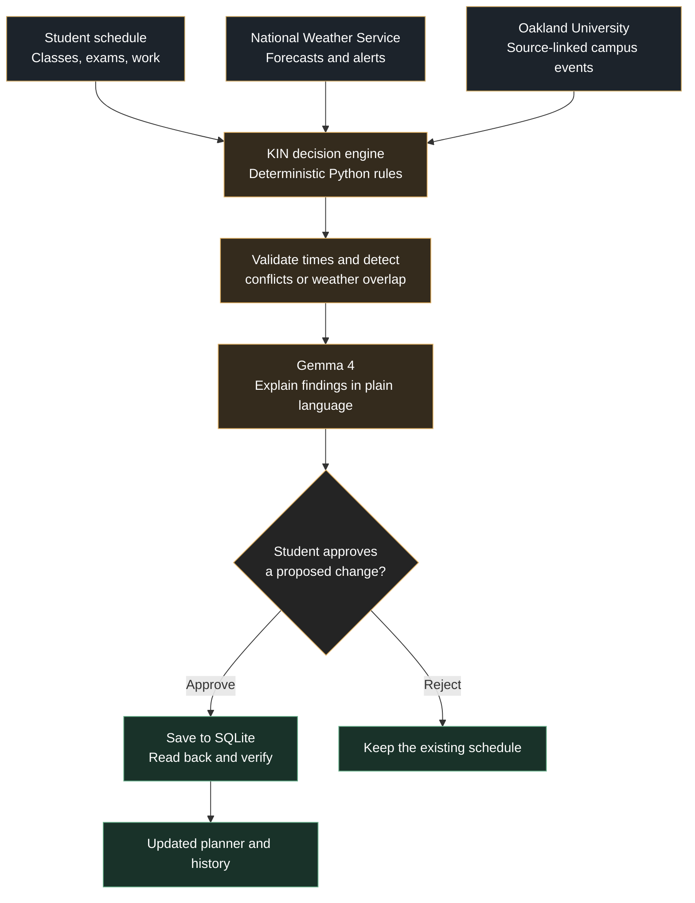

<p align="center">
  
</p>

<h1 align="center">KIN: Kinetic Intelligence Network</h1>

<p align="center"><em>Life changes. KIN moves with you.</em></p>

<p align="center">
  <a href="http://141.210.133.171:8501/"></a>
  <a href="https://github.com/mbilal-OU/KIN"></a>
  <a href="https://github.com/mbilal-OU/KIN/blob/main/LICENSE"></a>
</p>

<p align="center">
  <a href="http://141.210.133.171:8501/">Launch the KIN app</a> |
  <a href="#quick-start">Run locally</a> |
  <a href="#how-it-is-put-together">Architecture</a>
</p>

**Hacktoberfest Hack Day Rochester x GrizzHacks | 30 October 2026**

A student life companion for Oakland University. KIN connects a
fictional student's timetable with **live National Weather Service data** and
**real, source-linked OU athletics events**, detects time conflicts with
deterministic rules, and asks permission before it changes anything.

**Gemma 4** does the language work, reading free text into a structured
proposal, and explaining what the rules found. It never decides whether two
events clash, and it never decides whether a class is canceled.

> KIN is a student project. It is **not** an official Oakland University
> service and **not** an emergency notification system.

---

## Explore KIN

[**Open live demo**](http://141.210.133.171:8501/) | [**Free-first guide**](docs/FREE_FIRST.md) | [**How it works**](#how-kin-works) | [**Technology**](#technology-we-used) | [**Demo walkthrough**](#try-the-demo) | [**Tests**](#tests) | [**Trust and limitations**](#honest-limitations) | [**Ideas, Tasks & Roadmap**](docs/DEVELOPMENT_HUB.md)

## Free-first life planning (3 November 2026)

The next iteration adds useful **no-AI-required** features while keeping the original hackathon demo:

- **Manual repeating routines:** once, daily, weekdays or weekly, up to 12 weeks. These are expanded into individual local events, not a full recurring-series manager.
- **Fixed, flexible and protected** commitments. The user chooses what may be suggested for rescheduling.
- **Edit routines:** preview and approve changing or canceling one, future, or all saved manual recurring entries, with atomic write protection against stale previews.
- **Cross-workspace awareness:** find clashes between school, work and personal KIN workspaces; alternative slots consider all of your KIN workspaces by default. No external calendars are read.
- **Resolve conflicts:** rule-based suggestions for alternative time slots for flexible items, with explicit approval and read-back verification. Only the selected workspace is checked; no OU or employer schedule is changed.
- **Local planning Q&A and daily briefings:** common questions work with `KIN_AI_PROVIDER=off`, with no AI API requests or key. Gemma 4 is optional.
- **Voice assistant (opt-in):** push-to-talk, review speech recognition, ask KIN to explain conflicts or suggest free slots, and hear spoken replies using optional **local** Whisper + eSpeak NG. Voice commands **cannot approve or save calendar changes**. Requires optional installation and HTTPS or localhost for microphone access. [Voice setup](docs/VOICE.md).
- **Privacy-first default:** schedule detail sharing with external AI is opt-in for new profiles. This is still an unencrypted, guest-mode prototype and must not be used for private production records.

The home view and new manual dates now use the current Michigan day. The October 2026 fictional sample timetable is deliberately preserved for historical demonstration.

[**Free-first setup, feature boundaries and caveats**](docs/FREE_FIRST.md) | [**Tracked development tasks**](docs/DEVELOPMENT_HUB.md)

## How KIN works

KIN brings a student's commitments and real-world context together. **Rules identify the impact, Gemma explains it, and the student approves any change.**



> **The key distinction:** AI explains. Code verifies. You decide. A weather warning is not a confirmed university closure.

## Technology we used

| Layer | Technology | What we built |
|---|---|---|
| User interface | **Python, Streamlit** | Interactive planner, weather view, event discovery, approvals, assistant and settings |
| AI | **Gemma 4, Gemini API** | Natural-language event proposals and grounded explanations, with a local Ollama option |
| Scheduling logic | **Python** | Validated time zones, overlap detection, buffers and weather impact rules |
| Live data | **National Weather Service API** | Michigan forecasts and active weather alerts |
| Campus information | **Official OU source links** | Curated athletics events with provenance |
| Storage | **SQLite** | Local schedules, approval history and verified writes |
| Calendar portability | **iCalendar (.ics)** | Import previews and exports |
| Quality | **pytest, GitHub** | Automated offline tests, source control and documented limitations |

## Try the demo

<details>
<summary><strong>Scenario 1: A winter storm and an exam</strong></summary>

1. Open the [live KIN application](http://141.210.133.171:8501/).
2. View the fictional student timetable and its exam.
3. Enable the clearly labeled **simulated** winter warning.
4. See how KIN identifies the time overlap and explains the potential impact.
5. Check the official Oakland University closure source before drawing any conclusion about classes.

**What this demonstrates:** Source-aware context, deterministic impact checking and honest simulation labels.

</details>

<details>
<summary><strong>Scenario 2: Discover an Oakland University event</strong></summary>

1. Open **Discover OU** and inspect a source-linked athletics event.
2. Check how the event fits the student's existing timetable.
3. Propose adding it, then review the proposal.
4. Approve or reject the change.
5. If approved, KIN saves the event and verifies it by reading the stored record back.

**What this demonstrates:** Campus discovery, conflict detection and human-controlled writes.

</details>

<details>
<summary><strong>Scenario 3: Ask Gemma 4 for help</strong></summary>

1. Open the assistant screen.
2. Ask a planning question or describe a proposed commitment.
3. Review the model's explanation or structured proposal.
4. KIN validates proposed event details before any calendar action.
5. If the model is unavailable, the application labels its fallback instead of presenting it as an AI response.

**What this demonstrates:** An open-weight language model integrated with verifiable application logic.

</details>

**[Launch KIN](http://141.210.133.171:8501/)**

---

## What actually works

Reported verification on 30 October 2026:

| Capability | Status | Evidence |
|---|---|---|
| Live NWS hourly forecast + active alerts | **Working** | `tests/live_smoke.py` , 12 periods, office DTX |
| Gemma 4 free-text → validated event proposal | **Working** | `gemma-4-26b-a4b-it` via Gemini API |
| Gemma 4 grounded daily briefing | **Working** | Live call, no closure claim |
| Deterministic conflict / weather-impact engine | **Working** | 129 automated tests |
| Approval-gated calendar writes with verification | **Working** | Read-back confirmed before success is shown |
| Local SQLite persistence, export and erase | **Working** | Survives restart; one-click erase |
| Workspaces, assistant naming, guest mode | **Working** | Per-workspace alias, blank allowed |
| .ics import (with preview) and export | **Working** | TZID, UTC, all-day, duplicates, RRULE flagged |
| What-if simulator | **Working** | Never mutates the real timetable |
| Moodle / MySAIL sync, OAuth calendars, push/SMS | **Not built** | Needs authorization KIN does not have |

The **Settings & Trust** screen lists this honestly inside the app.

---

## Quick start

```powershell
# Windows PowerShell
cd path\to\KIN_Hacktoberfest_Starter
py -m venv .venv
.\.venv\Scripts\python.exe -m pip install -r requirements.txt
copy .env.example .env      # then edit .env and add your own key
.\.venv\Scripts\python.exe -m pytest -q
.\.venv\Scripts\python.exe -m streamlit run app.py
```

```bash
# macOS / Linux
cd /path/to/KIN_Hacktoberfest_Starter
python3 -m venv .venv
.venv/bin/python -m pip install -r requirements.txt
cp .env.example .env        # then edit .env and add your own key
.venv/bin/python -m pytest -q
.venv/bin/python -m streamlit run app.py
```

Then open <http://localhost:8501>.

### Free-first AI configuration

The planner works without a paid model or API key. The example configuration uses:

```ini
KIN_AI_PROVIDER=off
```

With AI off, manual routines, time-conflict checks, safe alternative slots, local schedule answers and rule-built briefings still work. To **optionally** use hosted Gemma 4 for free-text extraction and polished explanations, provide your own credentials in `.env` (never in a chat, screenshot or commit):

```ini
KIN_AI_PROVIDER=gemini
GEMINI_API_KEY=your_own_key_from_aistudio_google_com
KIN_GEMMA_MODEL=gemma-4-26b-a4b-it
```

Provider pricing, free-tier limits and data handling vary. OU's Gemini chat access is not KIN API authorization. **If enabling hosted Gemma 4, first install the optional SDK with `python -m pip install -r requirements-ai.txt`.** The default `requirements.txt` intentionally does not install an AI SDK.

**Fully local alternative** , nothing leaves your machine:

```ini
KIN_AI_PROVIDER=ollama
KIN_OLLAMA_MODEL=gemma4:e2b
```

(`ollama pull gemma4:e2b` first. Check Gemma prize eligibility for the local
route with the Rochester organizers if that matters to you.)

KIN runs without any key , the AI panels show a clearly labeled deterministic
fallback instead of pretending the model answered.

---

## Tests

```bash
python -m pytest -q          # 129 tests, no network, no API quota
python tests/live_smoke.py   # separate, manual: real NWS + real Gemma
```

The automated suite mocks every external call, so it is safe to run in CI and
cannot spend API quota. `live_smoke.py` is deliberately not named `test_*.py`.

---

## How it is put together

```text
Fictional student text ──> Gemma 4 extraction ──> strict JSON validation ──┐
                                                                           │
Stored timetable ──────────────────────────────────────────────────────────┤
                                                                           ├──> KIN rules
Live NWS forecast / alerts ──> source adapter (+ city, timestamp, status) ──┤     ├─ conflict / impact
                                                                           │     └─ opportunity fit
Curated OU events ──────────> provenance + estimated-end labels ───────────┘           │
                                                                                       v
                                                            Gemma 4 explains the structured result
                                                                                       │
                                                                 Proposal , no side effect yet
                                                                                       │
                                                                      User APPROVE / REJECT
                                                                                       │
                                                          Local write ──> read back ──> VERIFIED
```

Four trust boundaries:

1. **Untrusted text → validated data.** Model output is a *proposal*. It must
   pass `validate_event_proposal`, including that the UTC offset is the one
   America/Detroit genuinely uses on that date.
2. **External data carries provenance.** Every weather response records the city,
   coordinates, retrieval time and per-endpoint status.
3. **AI output is an explanation, not a command.** Gemma cannot call a tool,
   write to the calendar, or authorize anything.
4. **No state change without a click.** Approvals go
   `PROPOSED → APPROVED → EXECUTING → VERIFIED`, and `VERIFIED` is only set
   after reading the record back out of the database.

| Module | Responsibility |
|---|---|
| `kin_core.py` | Deterministic rules: overlap, buffers, impacts, validation, simulator |
| `kin_sources.py` | NWS client, OU source registry, curated event loading |
| `kin_ai.py` | Gemma calls, extraction, briefing, Q&A, labeled fallbacks |
| `kin_store.py` | Local SQLite persistence, export, erase |
| `kin_models.py` | Shared types, event taxonomy, record factories |
| `kin_calendar.py` | iCalendar import/export (standard library only) |
| `kin_theme.py` | Oakland University visual identity |
| `app.py` | Streamlit screens and orchestration |

More detail in [`docs/`](docs/): architecture, feature status, integrations,
security, testing, roadmap.

---

## The two demonstration loops

**A , Weather and an exam.** The sample timetable has a fictional 9:00 AM exam
on 31 October. Turn on the clearly marked SIMULATED winter warning (06:30-12:00)
and KIN finds the overlap with the exam *plus your travel buffer*, shows which
rule matched, and says plainly that no university cancellation is confirmed.
The simulated alert is rendered in its own dashed, purple-bordered section and
stays flagged `is_simulation` everywhere downstream, including in the AI prompt.

**B , A real OU event.** Discover OU shows Oakland Women's Volleyball vs
Milwaukee (Volloween Weekend) with its official Athletics source URL, the date
it was verified, and an explicit "end time estimated" badge. KIN checks it
against your timetable with your chosen buffer, you press *Propose*, and nothing
is stored until you press *Approve* in the Approval Center. The action log then
shows `VERIFIED` only because KIN re-read the row it wrote.

---

## Honest limitations

- **End times for sports events are planning estimates.** Only start times are
  from an official source.
- **Weather is one approximate coordinate**, not your actual route. KIN makes no
  road-safety or travel-time claim.
- **An API failure says "unavailable"**, never "no alerts". A zero-alert result
  is reported as "0 returned at retrieval time", not as a safety guarantee.
- **Class status is never inferred from weather.** Only the
  [official OU closings page](https://www.oakland.edu/police/emergency-management/campus-closings/)
  can confirm a closure, and KIN only links to it.
- **Guest mode means no account, not anonymity.** Data is stored in a local
  SQLite file; a hosted deployment would still process data server-side.
- **Storage is local and single-user.** It is not isolation, encryption, or
  authentication. Multi-user use would need real identities first.
- **No notifications leave the app.** There is no push, SMS or email delivery.
- **No compliance claims.** Not FERPA, SOC 2 or HIPAA certified; not affiliated
  with or endorsed by Oakland University.
- **Recurring .ics events** import as their first occurrence only, and say so.

---

## Sources

- NWS API: <https://www.weather.gov/documentation/services-web-api>
- NWS alerts: <https://www.weather.gov/documentation/services-web-alerts>
- OU campus closings: <https://www.oakland.edu/police/emergency-management/campus-closings/>
- OU registrar important dates: <https://www.oakland.edu/registrar/important-dates/>
- OU events calendar: <https://calendar.oakland.edu/>
- OU athletics: <https://goldengrizzlies.com/>
- Volleyball Oct 30: <https://goldengrizzlies.com/news/2026/10/29/womens-volleyball-volleyball-preps-for-series-with-milwaukee.aspx>
- Volleyball Oct 31: <https://goldengrizzlies.com/news/2026/7/8/womens-volleyball-golden-grizzlies-release-2026-volleyball-promotions-schedule.aspx>
- Gemma on the Gemini API: <https://ai.google.dev/gemma/docs/core/gemma_on_gemini_api>

Event records must be rechecked if used after 30-31 October 2026.

---

## License

Code is MIT (see [`LICENSE`](LICENSE)). Third-party models and data keep their
own terms. Oakland University names and marks belong to the university.
